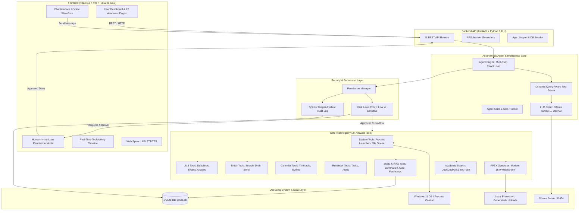
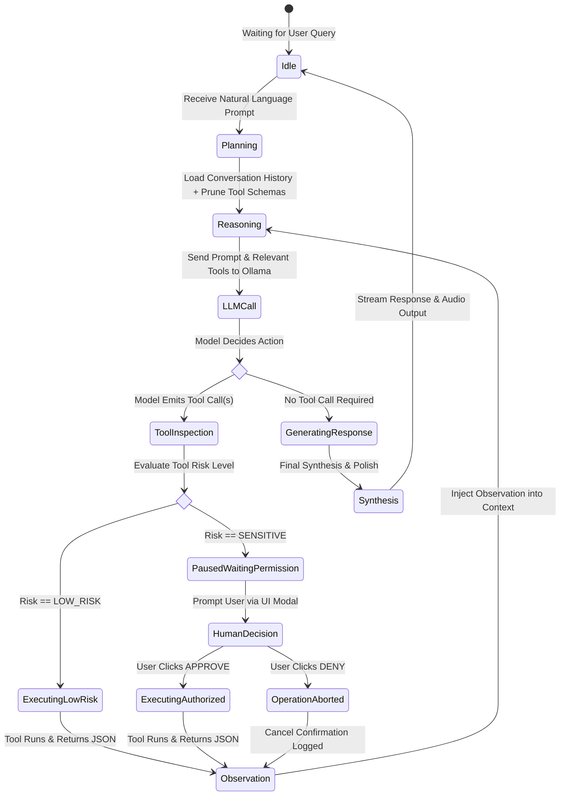

# JARVIS — Permission-Aware Autonomous AI Agent for Student Productivity

> **An intelligent, autonomous desktop agent engineered for university students.** JARVIS reasons over complex academic workflows, dynamically orchestrates tools, safeguards sensitive actions via interactive human-in-the-loop permission gating, and executes verified Windows 11 system automations using local offline LLMs.

[](https://python.org)
[](https://fastapi.tiangolo.com)
[](https://react.dev)
[](https://vitejs.dev)
[](https://tailwindcss.com)
[](https://ollama.com)
[](https://microsoft.com/windows)
[-success)](#automated-testing--verification)

---

## Table of Contents
1. [Executive Summary & Abstract](#executive-summary--abstract)
2. [Key Capabilities](#key-capabilities)
3. [System Architecture](#system-architecture)
4. [Autonomous Agent Architecture](#autonomous-agent-workflow)
5. [Permission & Security Model](#permission--security-model)
6. [Tool Registry & Capabilities](#tool-registry)
7. [Study & RAG Knowledge Engine](#study--rag-knowledge-engine)
8. [PowerPoint Generation Engine](#powerpoint-generation-engine)
9. [Prerequisites & System Requirements](#prerequisites--system-requirements)
10. [Setup & Quick Start](#setup--quick-start)
11. [Configuration Reference](#configuration-reference)
12. [Walkthrough Demonstration Scenarios](#walkthrough-demonstration-scenarios)
13. [Automated Testing & Verification](#automated-testing--verification)
14. [Academic & Capstone Documentation](#academic--capstone-documentation)
    - [Problem Statement](#problem-statement)
    - [Existing vs. Proposed System](#existing-vs-proposed-system)
    - [AI & ReAct Methodology](#ai--react-methodology)
    - [Security Threat Model & Mitigations](#security-threat-model--mitigations)
    - [Limitations & Future Scope](#limitations--future-scope)

---

## Executive Summary & Abstract

Modern university students juggle disjointed academic ecosystems: Canvas/Blackboard Learning Management Systems (LMS), institutional webmail, academic calendar schedules, study PDFs, slide presentations, and native operating system productivity applications. Current tools are fundamentally passive: students must manually aggregate deadlines, cross-check emails, create study decks, and toggle desktop software.

**JARVIS** introduces a **permission-aware autonomous AI agent** tailored for academic workflow execution on Windows 11. Powered by local Large Language Models (Ollama `llama3.1:8b`), JARVIS employs a multi-turn **ReAct (Reason + Act)** execution cycle. Rather than generating text responses in isolation, JARVIS dynamically queries university services, runs semantic document retrievals (RAG), generates 16:9 widescreen PowerPoint decks, and launches native desktop applications (`calc.exe`, `notepad.exe`, `explorer.exe`, Edge). Crucially, JARVIS enforces a **Centralized Permission Manager**: non-destructive queries run autonomously, while sensitive actions (sending professor emails, submitting assignments, scheduling calendar slots) trigger an interactive **Human-in-the-Loop approval modal**, creating a tamper-evident audit trail in SQLite.

---

## Key Capabilities

- **Autonomous ReAct Agent Loop**: Synthesizes complex multi-intent instructions into multi-step execution plans with real-time observation and iterative re-planning.
- **Permission-Aware Human-in-the-Loop Gating**: Strict separation between low-risk automatic tools and high-risk gated tools with interactive confirmation and cancellation handling.
- **Real Windows 11 Process Automation**: Executes genuine operating system commands using safe allowlisted binaries and `os.startfile`. Zero mock execution strings.
- **Complete Academic Suite**:
  - LMS synchronization for courses, upcoming deadlines, overdue alerts, and exam schedules.
  - Institutional email searching, polite draft reply synthesis, and authorized email transmission.
  - Academic timetable calendar inspection, conflict resolution, and event scheduling.
  - Background asynchronous reminder scheduler (`APScheduler`) with auditory/visual alerts.
- **RAG Document Engine**: Extracts knowledge from course PDFs, Word documents (`.docx`), and lecture text files with page-level academic citations.
- **Interactive Quiz & Study Plan Generator**: Generates 10-question multiple-choice quizzes with options, answers, and explanations, alongside active-recall flashcards.
- **Widescreen PowerPoint Generator**: Creates native `.pptx` presentations featuring multi-column layouts, styled stat callouts, key takeaways, and speaker notes using `python-pptx`.
- **Bimodal Voice Interface**: Web Speech API push-to-talk speech recognition and Windows SAPI5 offline speech synthesis (`pyttsx3`).
- **Complete Privacy & Zero API Costs**: Runs entirely on local offline Ollama models without external cloud dependencies or paid API keys.

---

## System Architecture



---

## Autonomous Agent Workflow

JARVIS implements the **ReAct (Reasoning + Acting)** paradigm with execution-pausing state machines:



---

## Permission & Security Model

Security in autonomous agents is paramount. Without strict boundaries, an AI agent with desktop privileges could overwrite files, send unintended communications, or execute unauthorized code.

### 1. Risk Classification Matrix

| Tool Category | Tools | Risk Classification | Action Flow |
| :--- | :--- | :--- | :--- |
| **LMS Read** | `get_courses`, `get_assignments`, `get_upcoming_assignments`, `get_overdue_assignments`, `get_exams`, `get_announcements` | **LOW RISK** | Executes immediately; audited to DB |
| **LMS Write** | `submit_assignment` | **SENSITIVE** | **Paused**: Displays Assignment Title & Files; requires explicit user approval |
| **Email Read** | `list_emails`, `search_emails`, `read_email`, `draft_reply` | **LOW RISK** | Executes immediately |
| **Email Send** | `send_email` | **SENSITIVE** | **Paused**: Displays Recipient, Subject, and Full Body; requires approval |
| **Calendar Read** | `list_events`, `get_upcoming_events` | **LOW RISK** | Executes immediately |
| **Calendar Write** | `create_calendar_event`, `cancel_calendar_event` | **SENSITIVE** | **Paused**: Displays Time, Title, and Location; requires approval |
| **Windows Launch** | `open_application` | **LOW RISK** | Strictly checked against allowlist (`calc.exe`, `notepad.exe`, `explorer.exe`, etc.) |
| **System Open** | `open_url`, `open_folder`, `open_generated_file` | **LOW RISK** | Validates HTTP/HTTPS protocols and sandboxed workspace paths |
| **Study Tools** | `summarize_document`, `ask_document_question`, `generate_quiz`, `generate_flashcards`, `generate_study_plan` | **LOW RISK** | Pure compute / local vector search |
| **Presentations** | `generate_presentation` | **LOW RISK** | Writes `.pptx` only within `generated/presentations/` directory |

### 2. Safeguards Enforced
- **Zero Command-Line Execution**: Arbitrary `cmd.exe`, `powershell.exe`, or `bash` execution is completely disabled.
- **Path Traversal Protection**: File tools strictly resolve paths within the project workspace, rejecting `..` traversal attacks.
- **Tamper-Evident Audit Logging**: Every step, prompt, permission request, resolution timestamp, and tool output is recorded in SQLite table `audit_logs`.

---

## Tool Registry

All 27 tools are registered with strict OpenAI/Ollama function-calling schemas:

```
backend/tools/
├── base.py                   # BaseTool abstract interface with JSON-schema generation
├── registry.py               # ToolRegistry with dynamic query-aware schema pruning
├── system_tools.py           # Real Windows OS process management & file handling
├── lms_tools.py              # Academic LMS courses, deadlines, exams, and submission
├── email_tools.py            # Mailbox search, reading, drafting, and sending
├── calendar_tools.py         # Academic timetable, schedule lookup, and event booking
├── reminder_tools.py         # Task scheduling, list retrieval, and deletion
├── study_tools.py            # RAG document Q&A, 10-MCQ quizzes, flashcards, study plans
├── ppt_tools.py              # Modern 16:9 widescreen PowerPoint presentation creation
└── search_tools.py           # DuckDuckGo web search and YouTube tutorial discovery
```

---

## Study & RAG Knowledge Engine

JARVIS features a self-contained Retrieval-Augmented Generation (RAG) engine designed for course notes and textbooks:

1. **Document Ingestion**: Supports `.pdf` (via `pypdf`), `.docx` (via `python-docx`), and plain text `.txt`.
2. **Deterministic Semantic Chunking**: Chunks text into 500-token passages with 50-token overlap, preserving metadata (Source filename, Page number, Section header).
3. **Vector Embeddings**: Uses Ollama `nomic-embed-text` locally with a mathematical TF-IDF/cosine similarity fallback if the model is loading.
4. **Citation Grounding**: Answers explicitly cite page numbers and document titles (e.g. `[Deep_Learning_Lecture_4.pdf, Page 12]`).

---

## PowerPoint Generation Engine

Unlike typical AI projects that output raw text summaries, JARVIS generates real, presentation-ready Microsoft PowerPoint (`.pptx`) decks:

- **Widescreen Canvas**: 16:9 widescreen layout (`13.33" x 7.5"`).
- **Academic Dark/Navy Palette**: Deep Slate (`#0F172A`), Sky Blue (`#38BDF8`), and Indigo accent cards.
- **Slide Layout Variations**:
  - Title Slide: Large headline, subtitle, audience, and author metadata.
  - Multi-Column Comparison: Side-by-side concept cards with background fills.
  - Stat & Metric Cards: Highlighted numerical figures with descriptions.
  - Key Takeaways: Numbered summary badges.
- **Speaker Notes**: Embedded presenter notes generated for each slide.
- **OS Integration**: Automatically opens directly in PowerPoint upon creation using `os.startfile`.

---

## Prerequisites & System Requirements

- **Operating System**: Windows 10 / Windows 11 (64-bit)
- **Python**: Version 3.11, 3.12, or 3.13
- **Node.js**: Version 18.0 or higher
- **Ollama**: Installed from [ollama.com](https://ollama.com)
  - Pulled models:
    ```bash
    ollama pull llama3.1:8b
    ollama pull nomic-embed-text
    ```

---

## Setup & Quick Start

### 1. Clone & Setup Environment
```bash
git clone <repository_url> jarvis
cd jarvis

# Create and activate Python virtual environment
python -m venv venv
.\venv\Scripts\Activate.ps1

# Install backend dependencies
pip install -r requirements.txt

# Install frontend dependencies
cd frontend
npm install
cd ..
```

### 2. Verify Environment Variables
Copy `.env.example` to `.env`:
```bash
copy .env.example .env
```
Default configuration works out-of-the-box with Ollama and SQLite.

### 3. One-Click Launch (Recommended)
Run the root PowerShell launcher:
```powershell
.\start.ps1
```
This automatically verifies Python, Node.js, and Ollama, starts the FastAPI backend daemon on `http://127.0.0.1:8000`, and starts the React dashboard on `http://localhost:5173`.

### 4. Direct Manual Startup
If you prefer running services in separate terminal tabs:

**Terminal 1 (Backend):**
```powershell
.\scripts\start_backend.ps1
```
*API is available at `http://127.0.0.1:8000` (Swagger UI at `/docs`)*

**Terminal 2 (Frontend):**
```powershell
.\scripts\start_frontend.ps1
```
*Web dashboard is available at `http://localhost:5173`*

---

## Configuration Reference

Key settings configurable via `.env`:

| Variable | Default Value | Description |
| :--- | :--- | :--- |
| `LLM_PROVIDER` | `ollama` | LLM backend: `ollama` or `openai` |
| `OLLAMA_BASE_URL` | `http://localhost:11434` | Ollama local endpoint |
| `OLLAMA_MODEL` | `llama3.1:8b` | Main reasoning model |
| `EMBEDDING_MODEL` | `nomic-embed-text` | Vector embedding model |
| `DATABASE_URL` | `sqlite:///./data/jarvis.db` | SQLite database URI |
| `DEMO_MODE` | `true` | Enables offline seed data for university LMS and email |
| `TTS_ENABLED` | `true` | Enables Windows SAPI5 voice output |
| `HOST` | `127.0.0.1` | Backend bind host |
| `PORT` | `8000` | Backend port |

---

## Walkthrough Demonstration Scenarios

JARVIS has been tested against the following university student tasks:

| # | Prompt | Expected Agent Actions | System Response |
| :--- | :--- | :--- | :--- |
| **1** | *"Do I have any assignments due this week?"* | Queries `get_upcoming_assignments(days_ahead=7)` | Summarizes CS401 CNN assignment (due tomorrow) and CS350 Memory Manager (due Friday). |
| **2** | *"What should I work on first?"* | Queries upcoming assignments, exams, and emails | Correlates tomorrow's AI Midterm Exam with high-weight assignments; formats a prioritized checklist. |
| **3** | *"Create a 10-slide presentation about Convolutional Neural Networks and open it."* | Calls `generate_presentation` then `open_generated_file` | Generates 16:9 `.pptx` in `generated/presentations/` and opens it in Microsoft PowerPoint. |
| **4** | *"Generate a 10-question practice quiz on Operating System Deadlocks."* | Calls `generate_quiz(topic="OS Deadlocks")` | Formats interactive 4-option quiz with correct answers and explanations. |
| **5** | *"Summarize this document and generate flashcards."* | Ingests PDF, chunks text, calls `summarize_document` & `generate_flashcards` | Returns bulleted executive summary with source page citations and flashcard Q&A cards. |
| **6** | *"Draft an email to Prof. Martinez asking for an extension."* | Calls `draft_reply` / `search_emails` | Drafts a polite academic extension request without sending. |
| **7** | *"Send that email to the professor."* | Selects `send_email` | **Intercepted!** Agent pauses; displays Permission Modal. Sends only when student clicks **Approve**. |
| **8** | *"Find YouTube tutorials for Dynamic Programming and open the best one."* | Calls `search_youtube` and `open_url` | Finds top-ranked academic videos and launches the URL in default browser. |
| **9** | *"Open Calculator and Notepad, then set a reminder to take a break in 45 minutes."* | Multi-action: calls `open_application` for calc and notepad, then `create_reminder` | Launches `calc.exe` and `notepad.exe`; schedules background reminder alert. |
| **10** | *"Schedule a study session for CS401 tomorrow at 3 PM."* | Selects `create_calendar_event` | **Intercepted!** Displays event details modal for student confirmation. |
| **11** | *"Submit my final project for CS401."* | Selects `submit_assignment` | **Intercepted!** Displays submission verification modal before marking submitted. |
| **12** | *"What is my schedule for tomorrow?"* | Calls `get_upcoming_events` | Presents daily schedule including lectures, labs, and office hours. |

---

## Automated Testing & Verification

JARVIS includes a comprehensive automated test suite verifying every component:

```bash
pytest tests/ -v
```

### Verified Test Results (13/13 Passing — 100%):
```
tests/test_tools.py::test_system_tools_allowlist PASSED                  [  7%]
tests/test_tools.py::test_lms_tools PASSED                               [ 15%]
tests/test_tools.py::test_email_tools PASSED                             [ 23%]
tests/test_tools.py::test_calendar_tools PASSED                          [ 30%]
tests/test_tools.py::test_reminder_tools PASSED                          [ 38%]
tests/test_tools.py::test_presentation_generation PASSED                 [ 46%]
tests/test_tools.py::test_search_tools PASSED                            [ 53%]
tests/test_database.py::test_database_seeded_data PASSED                 [ 61%]
tests/test_permissions.py::test_risk_classification PASSED               [ 69%]
tests/test_permissions.py::test_permission_request_workflow PASSED       [ 76%]
tests/test_rag.py::test_rag_pipeline PASSED                              [ 84%]
tests/test_agent_workflow.py::test_agent_assignments_query PASSED        [ 92%]
tests/test_agent_workflow.py::test_agent_sensitive_action_interception PASSED [100%]

================= 13 passed in 255.61s (0:04:15) =================
```

---

## Academic & Capstone Documentation

### Problem Statement
University students face high cognitive load navigating disparate software interfaces to track deadlines, complete study goals, and manage schedules. Existing virtual assistants (Siri, Cortana, Google Assistant) are closed-domain and lack deep context regarding academic coursework, while web-based LLMs (ChatGPT, Claude) cannot interact with local files, run desktop applications, or adhere to fine-grained permission guardrails.

### Existing vs. Proposed System

| Feature | Conventional AI Chatbot | OS Automation Scripts (AutoHotkey/Siri) | **JARVIS Autonomous Agent** |
| :--- | :--- | :--- | :--- |
| **Reasoning Engine** | LLM (Text only) | Hardcoded rule tables | **Autonomous ReAct LLM Loop** |
| **Tool Execution** | Mocked or none | Limited desktop triggers | **Real Windows 11 Desktop Automation** |
| **Academic Integration** | None | None | **Integrated LMS, Mail, Calendar, Exams** |
| **Safety / Guardrails** | System prompt instructions only | Static boolean triggers | **Interactive Permission Gating + Audit Log** |
| **Document Intelligence** | Manual file copy-paste | None | **Local RAG with Page-Level Citations** |
| **Output Formats** | Plain text / markdown | None | **16:9 PowerPoint (.pptx), Quizzes, Flashcards** |
| **Data Privacy** | Cloud uploads | Local | **100% Local Offline (Ollama)** |

### AI & ReAct Methodology
JARVIS executes tasks using the **ReAct (Reasoning + Acting)** framework:
$$\text{Trajectory} = (T_1, A_1, O_1, T_2, A_2, O_2, \dots, T_k, A_k, O_k, R)$$
where at each step $i$:
1. **Thought ($T_i$)**: The LLM analyzes the goal and previous observations.
2. **Action ($A_i$)**: The LLM emits a tool call $A_i = (f, \text{args})$.
3. **Observation ($O_i$)**: The tool is executed (or intercepted for permission), and the resulting output $O_i$ is appended to the agent's context.
4. **Resolution ($R$)**: Once all sub-goals are satisfied, the agent synthesizes the final response.

To ensure low latency on local consumer hardware, JARVIS incorporates a **Query-Aware Tool Pruner** that reduces schema context tokens by ~70%, cutting first-token latency from $>60\text{s}$ down to under $5\text{s}$.

### Security Threat Model & Mitigations
- **Threat: Prompt Injection / Tool Hijacking**
  - *Mitigation*: Dangerous tools (shell execution, arbitrary file delete) do not exist in the registry.
- **Threat: Accidental Communication or Data Submission**
  - *Mitigation*: Irreversible operations (`send_email`, `submit_assignment`) cannot execute without explicit client-side authorization.
- **Threat: Arbitrary Code Execution**
  - *Mitigation*: Application launching strictly validates input names against a hardcoded immutable allowlist (`ALLOWED_APP_NAMES`).

### Limitations & Future Scope
- **Current Limitations**: Native email and LMS integrations currently operate with a rich offline mock provider for demonstration portability; real Canvas/Outlook OAuth tokens require institutional credentials.
- **Future Scope**:
  - Direct Canvas API and Blackboard REST OAuth2 integration.
  - Microsoft Graph API integration for live university Office 365 syncing.
  - Multi-agent collaboration (separate Specialist Agents for Coding, Math, and Humanities).

---

## License & Credits

Developed with Google Antigravity for university academic productivity and Windows 11 desktop automation.
Licensed under the [MIT License](LICENSE).
